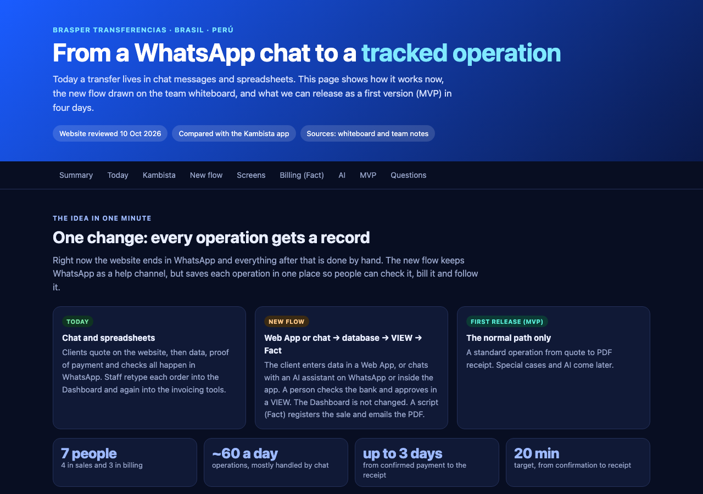

# BRASPER MVP: WhatsApp chat to tracked operation

> Product exploration **and a working Expo Go MVP** for **BRASPER**, a Brazil ⇄ Peru money-transfer / currency-exchange service (PIX ⇄ PEN). It turns a manual, WhatsApp-and-spreadsheet workflow into a tracked, auditable operation with a validation VIEW and an invoice/receipt step.

**🔗 Product plan: https://binnicordova.github.io/iathon-fintech/**

[](https://binnicordova.github.io/iathon-fintech/)

*(Static preview of [`reference/explore.html`](reference/explore.html): click it to open the full interactive page.)*

---

## The app (Expo Go, web + iOS + Android)

One codebase at the repo root, built from the [`expo-go-boilerplate`](https://www.npmjs.com/package/expo-go-boilerplate) template (Expo SDK 57, Expo Router, Jotai, `@expo/ui`). It runs in **Expo Go**, in a browser, and talks to the Firebase project **`aibrasper`**.

| Plan (see the page above) | In the app |
|---|---|
| Web App form, 5 screens | **Quote** → **Data (1/3)** → **Pay (2/3)** → **Proof (3/3)** → **Status** timeline (`src/app/(tabs)/index.tsx`, `src/app/order/*`) |
| In-app assistant, same service and steps | **Assistant** tab: a LangGraph agent with Gemma, one question at a time, rate card / payment / proof / status drawn by the app (`src/assistant/*`) |
| Human attention flow | "Hablar con una persona": queue position + estimated wait, leave for the assistant or the form any time (`src/app/human.tsx`) |
| VIEW for the team | **Team** tab: staff sign-in, filters, proof photo, approve / reject, mark + export orders CSV, run Fact |
| `orders` / `invoices` tables | Firestore `orders`, `invoices` (+ `quotes`, `handoffs`, `clients`), written **only** by Cloud Functions |
| Exchange-rate provider | `open.er-api.com` primary, `fawazahmed0` backup, cached by our server; Brasper rate = market − spread; "next update" = last refresh + interval; never shows 0 |
| Fact billing script | Idempotent test-mode run: reserve number → XML → PDF built from the XML → result on the order; client downloads the PDF |
| Hours, fees, tax | Mon–Fri 7–18 / Sat 8–14 / Sun 12–14 (Lima); commission + 18% tax; "outside hours" message on the pay screen |
| ES · PT · EN | Whole UI and the assistant |

### Run it

```bash
bun install
bun run start          # Expo dev server; press w (web), i (iOS simulator) or scan the QR in Expo Go
```

The app already points at the deployed `aibrasper` backend (the Firebase *web* config in `src/constants/firebase.ts` is not a secret; access is enforced by rules and Functions). To work offline against the local emulators:

```bash
bun run functions:install && bun run emulators          # Firestore, Auth, Storage, Functions
echo 'EXPO_PUBLIC_FIREBASE_EMULATOR_HOST=localhost' >> .env.local   # 10.0.2.2 on the Android emulator, your LAN IP on a phone
bun run mock:gemma                                      # optional: a fake Gemma, to try the tool-calling path with no credits
```

Expo Go notes:

* Since SDK 57 the Expo Go app and the Expo CLI must both be logged in to the same Expo account.
* The Expo Go on the App Store (57.0.9 when this was built) bundles older native modules than the newest SDK 57 JS patches. **Do not run `expo install --fix`**: it bumps `@expo/ui` and the UI renders black on iOS. The pinned versions in `package.json` are the ones verified in Expo Go, and `expo.install.exclude` keeps them from being "fixed".

### Environment (`.env.local`, see `.env.example`)

| Variable | Purpose |
|---|---|
| `EXPO_PUBLIC_SENTRY_DSN` | Turns Sentry on (errors, traces, the LangGraph `gen_ai.*` spans). Empty = every Sentry call is a no-op |
| `EXPO_PUBLIC_SENTRY_RECORD_AI_CONTENT` | `true` also sends prompts/replies to Sentry. **Off by default**: the chat carries ID numbers and bank accounts |
| `EXPO_PUBLIC_WHATSAPP_NUMBER` | Number for the "Talk on WhatsApp" button (`wa.me`); empty opens WhatsApp's chat picker |
| `EXPO_PUBLIC_FIREBASE_EMULATOR_HOST` | Use the local emulators |

---

## Architecture

```
Expo app (web / iOS / Android)                       Firebase project aibrasper (southamerica-east1)
┌─────────────────────────────────────┐             ┌────────────────────────────────────────────┐
│ Form screens ─┐                     │  callable   │ getRates · createQuote · createOrder       │
│               ├─ same stores/services├────────────▶│ submitProof · cancelOrder · requestHuman   │
│ Assistant ────┘  (Jotai + Firebase)  │             │ reviewOrder · exportOrders · runFact       │
│  LangGraph graph                    │             │ getReceipt · assistantGenerate (Gemma)     │
│  └ agent ⇄ tools (zod, validated)   │  Firestore  │                                            │
│  Sentry.instrumentStateGraph        │◀───────────▶│ orders · invoices · quotes · handoffs ...  │
└─────────────────────────────────────┘  (read-only │ rules: clients read their own, staff all,  │
        │ proof photo (private)           for clients)│        nobody writes from the app          │
        └────────────────────────────────▶ Storage    └────────────────────────────────────────────┘
```

* **Server is the source of truth.** The app prices live for a good calculator feel, but `createQuote` re-prices on the server and freezes the rate; `createOrder` takes rate, fees and the payment account from that quote, never from the request. Pricing, validators and the status machine live once in `src/domain` and are copied into the functions at build (`functions/scripts/copy-shared.mjs`), so both sides compute the same numbers.
* **Roles.** Clients are anonymous Firebase users (no sign-up friction). Staff are email users with a `role` custom claim: `validator`, `operator`, `billing` or `admin` (`functions/scripts/grant-staff.mjs`).
* **Money rules in code, not in the prompt.** The assistant has no tool that approves, exports or creates an order. Order creation, hand-over and payment steps run from the app's own buttons. Tool arguments are validated with zod, a wrong tool call comes back as an error, and a runaway loop stops at the recursion limit.

### The assistant: LangGraph + Gemma + Sentry

* `src/assistant/graph.ts`: a `StateGraph` (`agent` ⇄ `tools`) whose state carries the messages plus the cards and quick replies the UI draws. It follows [Sentry's React Native LangGraph guide](https://docs.sentry.io/platforms/react-native/guides/expo/integrations/langgraph/): the OpenTelemetry integration does not run in React Native, so the graph is wrapped with `Sentry.instrumentStateGraph` before `compile()`, and model/tool calls get `gen_ai.chat` / `gen_ai.execute_tool` spans.
* **Model: Gemma 4** (`gemma-4-26b-a4b-it`, Google's open model) through the Gemini API, called by the `assistantGenerate` function, so **the API key never reaches the app bundle** (the same advice Sentry gives). The function allow-lists the request shape.
* **Rate card, fees and accounts are never written by the model.** Tools return a card id; the app renders the numbers from the server's quote or order. The model is told it must not repeat figures.
* **Basic mode.** If the model is unreachable (no credits, offline, quota), the same tools drive a scripted conversation (`src/assistant/basic.ts`), so a client can still finish a transfer in chat. The assistant tab shows a notice when this is on.
* **Hand-over.** `request_human` queues the client with a summary of the quote, collected fields and order, so the seller starts with context.

### Making LangGraph run on a phone (what was needed)

| Problem | Fix |
|---|---|
| Metro dev crash "Cannot access 'Client' before initialization" (`langsmith` ESM cycle vs. React Refresh) | `metro.config.js` resolves `langsmith/*` to its CommonJS build |
| `crypto`, `navigator.userAgent`, `AbortSignal.throwIfAborted` missing in Hermes | `src/polyfills.ts` |
| `Sentry.instrumentStateGraph` missing in `@sentry/react-native` 7.x | pinned to 8.30 (excluded from `expo install --fix`) |
| `getSentryExpoConfig` stubs `@sentry/core`'s LangGraph tracing on native, so the helper is `undefined` on iOS/Android | `metro.config.js` lets those two modules through |
| Gemini rejects JSON-schema keywords such as `exclusiveMinimum` | `src/assistant/schema.ts` allow-lists the Gemini subset |

---

## Firebase project `aibrasper`

Deployed: Firestore (`southamerica-east1`) + rules + indexes, Storage rules (private proof photos), 13 callable Cloud Functions (Node 24, 2nd gen), Auth (anonymous + email/password), secret `GEMINI_API_KEY`.

```bash
bun run deploy:backend      # firestore rules + indexes, storage rules, functions
bun run build:web && firebase deploy --only hosting   # optional: publish the web app (not done yet)
```

**Create a staff user** (your own email; nothing is pre-created in production):

```bash
gcloud auth application-default login
node functions/scripts/grant-staff.mjs you@brasper.com admin --password '<choose one>'   # creates the user, then sets the role
```

**Reset the test data before launch.** Testing leaves orders, quotes, a client, proof photos and anonymous users in production, and the order counter would start at `BR-0002`. The script lists what it would remove and deletes nothing without `--yes`; it keeps `config/*` and every user that has an email:

```bash
bun run reset:test-data                           # dry run
bun run reset:test-data -- --yes --anonymous-users
```

**Synthetic demo data.** `bun run seed:demo` adds 12 made-up orders in every status (with proof photos), and hand-over tickets, all marked `synthetic: true` and using `example.com` emails, so the Team tab is not empty in the demo. Run it after `reset:test-data`; it refuses to run twice without `--force`. Invoices are not seeded: press Fact on the approved orders.

**Gemma credits.** The Gemini API answered `402 prepayment credits depleted` for this project when tested, so live Gemma replies need credits (or a free-tier key) in [AI Studio](https://ai.studio/projects). Until then the app runs in basic mode. Once fixed, no redeploy is needed for the same project; to use a different key:

```bash
firebase functions:secrets:set GEMINI_API_KEY --project aibrasper   # then: firebase deploy --only functions
```

---

## Tests

```bash
bun run test                  # 101 Jest tests: pricing, validators, hours, status machine, assistant graph, tools, basic mode
bun run functions:build       # compile the functions (copies src/domain + src/models first)
bun run emulators             # in another terminal, then:
bun run e2e:emulator          # quote → order → proof → validate → export → Fact → receipt, plus the security checks
TARGET=prod FIREBASE_API_KEY=<web api key> node functions/scripts/e2e-emulator.mjs   # client half against production
```

`bun run check:unused` runs Biome and the type check. `npx expo-doctor` passes 21/21.

---

## What is real and what is a placeholder

| Piece | Status |
|---|---|
| Quote, form, assistant, queue, VIEW, order/invoice records, CSV export, PDF receipt | Full flow verified on web against the emulators (`e2e:emulator`); client half verified against production; in Expo Go on iOS the quote, the form and the assistant (LangGraph + Sentry spans, basic mode) were driven against production |
| KeyFácil (SUNAT) / Omni | **Not connected** (no test access yet). Fact runs against a stand-in provider that always accepts; the XML and PDF are labelled **TEST MODE, no fiscal validity** |
| Receipt email | Not sent (no mail provider). The client downloads the PDF in the app |
| Fees and tax | Placeholders: 2.4% commission (back-solved from the spec's 11.98 on 500), 18% tax, 2% rate spread. Real values go in Firestore `config/public` (`pricing`) |
| Brasper bank accounts | **DEMO** accounts, flagged on screen. Real ones go in `config/payment` |
| Dashboard import format | Unknown (open question #1): the exported CSV follows the plan's `orders` table |
| WhatsApp / Telegram | The assistant graph is transport-agnostic (`AssistantDeps`) and can move to a function; the in-app channel is what ships. The WhatsApp button opens a prefilled chat |
| Android | **Not run on a device or emulator** (no disk for an AVD here). `expo export --platform android` compiles the Hermes bundle, and Android uses the Compose-backed Expo UI code path; try it in Expo Go before the demo |

## Repository layout

| Path | Purpose |
|---|---|
| `src/app/` | Expo Router routes (tabs, order steps, human queue) |
| `src/components/` | Atomic design: atoms, molecules, organisms, templates |
| `src/domain/`, `src/models/` | Pure rules and types, shared with the functions |
| `src/assistant/` | LangGraph graph, tools, prompt, Gemini adapter, basic mode |
| `src/services/`, `src/stores/`, `src/hooks/` | Firebase access, Jotai state, data hooks |
| `src/i18n/` | ES, PT, EN |
| `functions/` | Cloud Functions + scripts (`grant-staff`, `e2e-emulator`, `mock-gemma`) |
| `firestore.rules`, `storage.rules`, `firebase.json` | Firebase project config |
| `reference/` | Static planning docs, screenshots and whiteboard (published to GitHub Pages) |
| `.github/workflows/pages.yml` | Deploys **only** `reference/` to Pages |

## License

MIT (see `license`).
