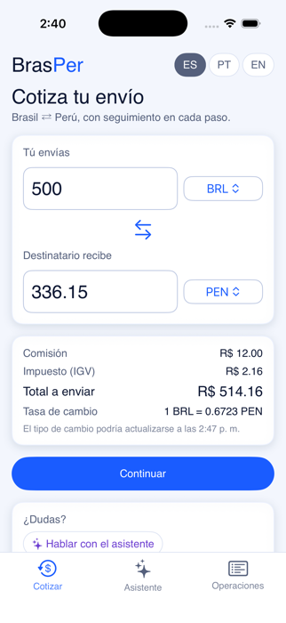
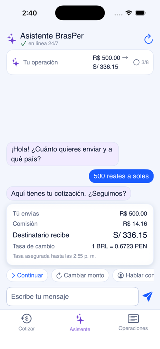
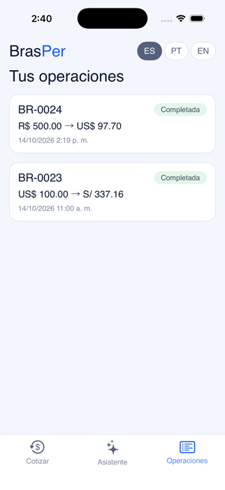
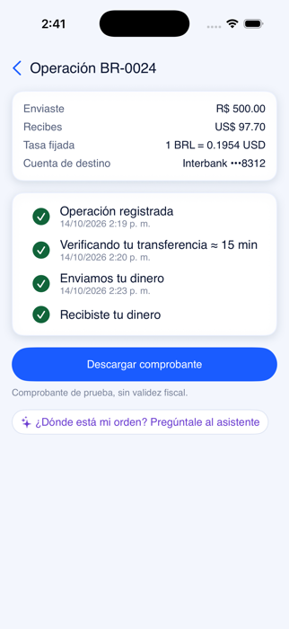
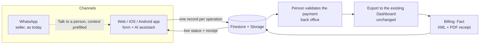
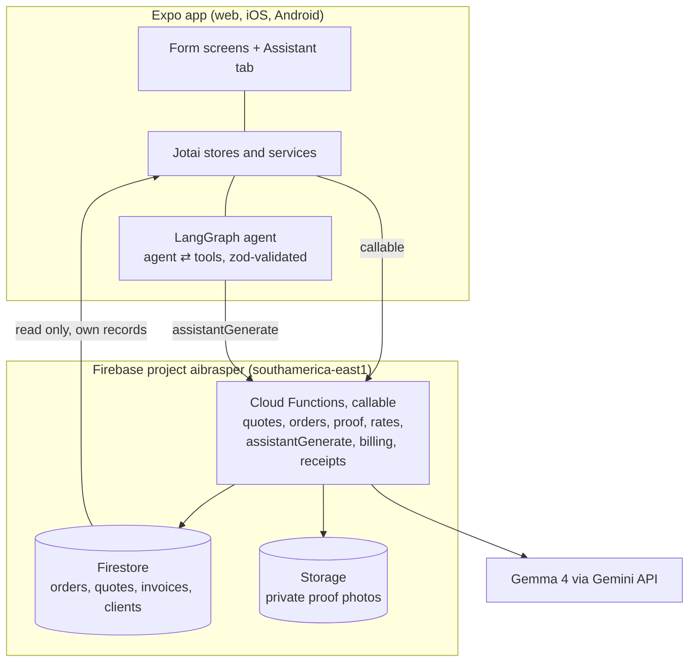

# BRASPER: from a WhatsApp chat to a tracked operation

> A mobile app and an AI assistant for **BRASPER**, a Brazil ⇄ Peru money-exchange and transfer business (PIX ⇄ PEN). Built for **IATHON Perú 2026** as a working MVP on web, iOS and Android.

**Author:** [BinniCordova.com](https://binnicordova.com) · **Team 5.5**, [IATHON 2026](https://lnkd.in/p/d5fZDx7k)

**Product plan and analysis:** https://binnicordova.github.io/iathon-fintech/ · **Back-end API guide:** [functions/docs/README.md](functions/docs/README.md) · **Order lifecycle:** [functions/docs/order-lifecycle.md](functions/docs/order-lifecycle.md)

<p align="center">
  
  
  
  
</p>
<p align="center"><sub>Quote · Assistant · Orders · Completed order with PDF receipt (iPhone 17 Pro simulator in Expo Go, against the deployed Firebase project)</sub></p>

---

## Resumen en español

BRASPER cambia dinero entre Brasil y Perú. Hoy una operación vive en chats de WhatsApp y hojas de cálculo: el cliente cotiza en la web, termina en WhatsApp, un asesor pide los datos, revisa una captura del pago y vuelve a escribirlo en el sistema; la boleta puede tardar hasta 3 días. Esta solución agrega **un canal más**, una app (Expo, funciona en web, iOS y Android) con un **asistente de IA** que cotiza, recoge los datos, guía el pago y muestra el estado, y **guarda cada operación en un solo registro** para que una persona la valide y se facture sin reescribir nada. WhatsApp sigue como canal de ayuda: "Hablar con una persona" abre el chat de BRASPER con el contexto ya escrito. Más abajo están el análisis del negocio, las capturas, la arquitectura y las referencias.

---

## 1. The business: BRASPER

BRASPER moves money between Brazil and Peru. A client sends reais by PIX and the recipient gets soles in a Peruvian bank (or the other way round). The facts below come from the team's diagnosis in the [product plan](https://binnicordova.github.io/iathon-fintech/) (the numbers are the team's estimates, not measured):

| Today | |
|---|---|
| People | 7 (4 in sales, 3 in billing) |
| Volume | about 60 operations a day, mostly handled by chat |
| Receipt | up to 3 days after the payment is confirmed (target: 20 minutes) |
| Support hours | Mon–Fri 7–18, Sat 8–14, Sun 12–14 (Lima); outside them only self-service works |

**How an operation works today:** the client quotes on the website and taps "Enviar por WhatsApp" → a sales agent agrees the rate and collects the data in the chat → the client pays and sends a screenshot → the agent looks at it and types the order into the Dashboard → billing re-checks it and registers the sale in KeyFácil (Peru → Brazil) or Omni (Brazil → Peru) → the receipt is emailed.

**What gets in the way** (from the plan): the website saves nothing, so its only output is a WhatsApp message; proof of payment is a screenshot checked by eye with no record of who decided (a fraud risk); the same data is typed twice (Dashboard, then the billing tool); there is no defined data structure; and everything waits on a chat queue.

## 2. The objective

> Turn every operation into **one record**, created by the client in whichever channel they prefer, validated by a person, and billed from the same data, **without replacing WhatsApp or changing the Dashboard.**

For IATHON Perú 2026 this repository is a working MVP of that idea, not a mock-up: a real quote engine, a real database, real Cloud Functions and a real LLM agent, running against a deployed Firebase project.

**In scope (the normal path):** quote → data → payment instructions → proof of payment → status timeline → PDF receipt, by form or by chat, in Spanish, Portuguese and English. A person validates every payment.
**Left for later:** real KeyFácil/Omni integration, a screen for the team (the back office runs through the Cloud Functions today), email delivery of receipts, analytics (deliberately out: that belongs in a dedicated tool such as Datadog or Google Analytics).

## 3. The solution: an app and an agent inside it

The app is **an additional channel**, not a replacement. It shares one back end with every other way in.



| Screen | What it does |
|---|---|
| **Quote** | Live calculator (BRL · PEN · USD). The server re-prices and freezes the rate for 15 minutes; the exchange rate never shows 0. |
| **Assistant** | A LangGraph agent on Google's open model Gemma 4. It asks one question at a time, never states a rate or an account number itself (the app draws those from the server), and never approves anything. |
| **Data → Pay → Proof** | The same three steps by form or by chat: source of funds, accounts in the client's own name, where to pay with copy buttons, operation number and proof photo. Saved accounts so returning clients do not retype. |
| **Operations / Status** | A live timeline (registered → verifying → sent → received) and a PDF receipt when billing accepts the sale. |
| **Talk to a person** | Opens BRASPER on WhatsApp with the quote and what the assistant already collected, so the seller starts with context. |

## 4. Why an app, and why it complements WhatsApp

**Retention is where the money is.** Frederick Reichheld of Bain & Company is widely quoted for the finding that raising customer retention by 5% can lift profits by 25% to 95%, and acquiring a new customer can cost five to 25 times more than keeping one ([HBR, Amy Gallo, 2014](https://hbr.org/2014/10/the-value-of-keeping-the-right-customers)). The figures are repeated often and the original study is hard to find, so read them as an order of magnitude, not a promise. For a business with a repeat client (the same person sending money to family every month), a place that remembers their accounts and shows every past operation is the cheapest way to keep them.

**Finance apps keep their users.** In the Mobile Finance Report by Adjust and App Annie (first half of 2019, 90+ apps, 36 countries), banking apps kept 32% of users on day 1 and 15% on day 30, third best of 15 app categories ([summary](https://martechseries.com/mobile/in-app-marketing/mobile-banking-apps-score-highest-user-loyalty-level-new-report-from-adjust-and-app-annie-reveals/)). The data is old and about banks, not exchange houses, but it shows that people open money apps repeatedly. A chat thread, by contrast, is one more conversation in a crowded inbox.

**Omnichannel means adding a channel, not forcing a switch.** A Harvard Business Review study of about 46,000 shoppers of one US retailer ([Sopadjieva, Dholakia and Benjamin, 2017](https://hbr.org/2017/01/a-study-of-46000-shoppers-shows-that-omnichannel-retailing-works)) found that most customers used more than one channel, and that those who used several spent more than single-channel customers. As summarised by [secondary coverage](https://www.bareinternational.com/bare-shares-study-shows-omnichannel-retailing-works/): 73% were multichannel, and they spent about 4% more in store and 10% more online per shopping occasion. That is retail, not finance, so the transferable lesson is the shape of the result: the valuable customer is the one who moves freely between channels. BRASPER's clients already live in WhatsApp; the app gives them a faster path for the routine case and leaves WhatsApp for the exceptions.

**What the app can do that a chat cannot:** push alerts when the transfer arrives, saved accounts and one-tap repeat transfers, the camera for the proof photo, a status screen that does not need anyone to answer, biometric login later, and a record of the history. The plan makes the same argument ("the app earns its place with weekly use") and flags that "mostly WhatsApp" has not been measured yet. Measuring it is the first thing to do after launch (section 6).

## 5. Who the clients are

These segments are **hypotheses to validate with BRASPER's own data** (first step: count who the roughly 60 daily operations come from). They are chosen from the corridor and from what the evidence says about who uses apps to move money.

| Segment | Why they would use the app | Evidence |
|---|---|---|
| **Peruvians living in Brazil** sending money home or paying obligations | Already pay with PIX every day; want a clear rate and a receipt | About 70,000 Peruvians lived in Brazil in 2017 by the Peruvian consulate's estimate (35,000 in São Paulo), cited in a [São Paulo city bill](https://www.saopaulo.sp.leg.br/iah/fulltext/justificativa/JPL0689-2017.pdf); a consular figure, not a census |
| **Brazilians living or working in Peru** | Same corridor in reverse; use Yape or Plin locally | 9,501 Brazilians, 0.7% of 1.35 million foreign residents in Peru (Migraciones data, August 2021, [reported by Trome](https://trome.com/actualidad/un-millon-347-mil-extranjeros-viven-en-el-peru-fotos-video-imp-noticia/)) |
| **Small traders, importers and freelancers** | Need a proper receipt (the Fact step) and repeat transfers to the same accounts | The plan's billing flow (SUNAT through KeyFácil, Omni in Brazil) exists because these clients need an invoice |
| **Travellers and students** | One-off transfers; want certainty about the rate and the delivery time, outside office hours | The plan's short support hours leave evenings and weekends to self-service |

**Why this audience is reachable with an app.** Both countries have moved to instant, phone-based payments:

- **Brazil:** by the Banco Central do Brasil's statistics as reported by the press, Pix handled 42.9 billion transactions in the second half of 2025, 54.7% of all retail payments ([Let's Money](https://www.letsmoney.com.br/noticias/pix-547-transacoes-brasil-segundo-semestre-2025-banco-central)), and 148.3 million people used it in December 2025, about 86% of Brazilian adults ([Movimento Econômico](https://movimentoeconomico.com.br/economia/2026/08/11/chaves-pix-chegam-a-920-milhoes-e-sistema-movimenta-r-35-tri-em-2025/)). A study by FGV on Pix's first five years shows the average payment settling near R$ 190, which means everyday use ([FGV EAESP](https://eaesp.fgv.br/sites/default/files/arq-publicacao/2026-08/5-anos-do-pix-10-perguntas-para-entender-como-ele-se-espalhou-pelo-brasil-1.pdf)).
- **Peru:** Yape and Plin have displaced cards for everyday payments ([Infobae, 2025](https://www.infobae.com/peru/2025/05/03/billeteras-digitales-como-yape-y-plin-estan-desplazando-a-las-tarjetas-de-credito-por-que/)). User counts vary a lot by source and date (roughly 14 to 20 million for Yape), so treat any single number with care. The central bank has pushed wallet interoperability since 2022 ([BCRP white paper](https://www.bcrp.gob.pe/eng-docs/Publications/white-paper-interoperability.pdf)) and is building an instant-payment platform, TAPP, with a pilot planned for late 2026 ([La Cámara](https://lacamara.pe/tapp-la-nueva-plataforma-de-pagos-del-bcrp-permitira-ampliar-servicios/)).
- **The gap is the opportunity.** I found no official Pix–Peru link. Where Pix works in Peru it is a private arrangement, for example [Prometeo enabling Pix payments at the Copa Libertadores final in Lima](https://www.computerweekly.com/es/noticias/366636319/Prometeo-habilito-pagos-con-Pix-en-la-final-de-la-Copa-Libertadores-en-Peru). Until the two rails are connected, somebody has to bridge them, and the client expects that bridge to feel like their wallet.
- **Price pressure:** the World Bank tracks remittance costs and its goal is 3% ([Remittance Prices Worldwide](https://remittanceprices.worldbank.org/)). Summaries of its 2025 data put sending US$ 200 at about 4.6–4.9% through digital channels against about 7.2–7.3% through non-digital ones ([Market.us summary](https://market.us/report/digital-money-transfer-and-remittances-market/); check the World Bank report for the exact figures). Digital is already the cheaper way to send, and clients will compare. (BRASPER's pricing in this repo is a placeholder: 2% spread + 2.4% commission + tax on the commission is about 4.8% in total.)

A comparable product is **Kambista**, a Peruvian exchange app; the team's walkthrough of its flow (three steps, saved accounts, a status timeline) is in [reference/kambista-benchmark.html](reference/kambista-benchmark.html) and shaped the data, pay and status screens.

## 6. How BRASPER is impacted

| | Today | With the app and agent |
|---|---|---|
| **Quote to order** | Chat with a seller, data typed in a message | The client enters it once, by form or by chat; one record per operation |
| **Proof of payment** | A screenshot checked by eye, no record | Operation number checked for duplicates, photo stored privately, who approved and when is saved |
| **Retyping** | Dashboard, then the billing tool | The same record feeds the validation step, the Dashboard export (CSV) and billing |
| **Waiting** | A chat queue, outside office hours nobody answers | The assistant answers at any hour; a person only validates the payment |
| **Receipt** | Up to 3 days | Generated from the record as soon as billing accepts it (the team's target is 20 minutes) |
| **Repeat clients** | Start again in the chat | Saved accounts, history, one place to look |
| **Hard cases** | Everything goes to a seller | Large or negotiated amounts go to a person on WhatsApp with the context attached |

**Where the team's time goes.** The routine operation stops needing a human until the payment check, so the four people in sales spend their time on what needs judgement (large amounts, doubts, fraud signals) and the three in billing stop retyping. This is an expectation, not a measurement.

**How we will know it worked** (the plan's own metrics, measured in a proper analytics tool, not in this app):

1. Time from confirmed payment to receipt (today up to 3 days, target 20 minutes).
2. Share of operations created without a seller typing anything.
3. Share of clients who return within 30 days, and through which channel.
4. Share of assistant conversations that end in an order without a hand-over.
5. Duplicate or mismatched operation numbers caught before approval.

## 7. The agent

The assistant is the part most likely to go wrong in a money product, so it is built to be **limited by code, not by promises in a prompt.**

- **It talks, the app does.** The model has tools (get a quote, save a client field, show payment instructions, show order status, offer WhatsApp). Rate cards, fees, totals and bank accounts are drawn by the app from the server's data; the model is told never to repeat them. No tool approves, exports or creates an order: those are the app's own buttons.
- **Everything is validated twice.** Tool arguments go through zod; document numbers (CPF, DNI, RUC, CE) are checked with their real check digits; a wrong tool call comes back as an error and a runaway loop stops at a recursion limit.
- **It degrades instead of failing.** If the model cannot be reached, a scripted "basic mode" runs the same tools and the client can still finish a transfer.
- **A person is always one tap away.** The assistant offers WhatsApp when asked, for large amounts or when unsure.
- **Fast.** On the deployed proxy a model call takes about 1–2 seconds (it took about 4–5 s before asking Gemma for minimal "thinking"), and turns whose answer is a card (quote, payment, status, the next question) make one model call instead of two. A turn that took about 8 seconds now takes about 2.
- **Observable.** The graph is wrapped with `Sentry.instrumentStateGraph`, following [Sentry's React Native LangGraph guide](https://docs.sentry.io/platforms/react-native/guides/expo/integrations/langgraph/), so model and tool calls show as `gen_ai.*` spans. Prompts are not sent to Sentry by default because chats carry ID and bank numbers.
- **The key never ships in the app.** The model is called by the `assistantGenerate` Cloud Function, which holds the API key.

**What others learned.** Bank of America's assistant Erica passed 2 billion interactions and 42 million clients since 2018, with over 98% of clients getting their answer in about 44 seconds ([Bank of America, April 2024](https://newsroom.bankofamerica.com/content/newsroom/press-releases/2024/04/bofa-s-erica-surpasses-2-billion-interactions--helping-42-millio.html)). Klarna's assistant handled 2.3 million conversations in its first month, two thirds of its chats, cutting resolution from 11 minutes to under 2 ([Klarna, February 2024](https://www.klarna.com/international/press/klarna-ai-assistant-handles-two-thirds-of-customer-service-chats-in-its-first-month/)). Klarna's chief executive later said the cost-cutting had gone too far and that customers must always be able to reach a person ([TechCrunch, June 2025](https://techcrunch.com/2025/06/04/klarna-ceo-says-company-will-use-humans-to-offer-vip-customer-service); [CX Today](https://cxtoday.com/klarna-grapples-with-ai-led-customer-service-pivots-to-an-uber-type-of-setup)), while still reporting large savings from the assistant. Both are company-reported figures. The lesson used here: automate the routine, keep the human for the nuanced, and make the hand-over easy.

---

## 8. Technical overview

### Architecture



- **The server is the source of truth.** The app prices live for a good feel, but `createQuote` re-prices and freezes the rate, and `createOrder` takes rate, fees and the payment account from that quote, never from the request. Pricing, validators and the status machine live once in `src/domain` and are copied into the functions at build, so both sides compute the same numbers.
- **Clients are anonymous Firebase users** (no sign-up friction) who can read only their own records. Nothing writes orders, quotes or invoices from the app: Firestore rules deny it.
- **Status machine:** `pending → validating → approved → exported`, plus `rejected` and `cancelled`. After the client's proof, only the back office moves an order on.
- **Back office:** `reviewOrder`, `exportOrders` and `runFact` are Cloud Functions for staff roles (`validator`, `operator`, `billing`, `admin`). There is no staff screen in the app on purpose. See the [API guide](functions/docs/README.md) and the [order lifecycle](functions/docs/order-lifecycle.md) (a sequence diagram and every field involved).

### Run it

```bash
bun install
bun run start          # Expo dev server; press w (web), i (iOS simulator) or scan the QR in Expo Go
```

The app already points at the deployed `aibrasper` backend (the Firebase *web* config in `src/constants/firebase.ts` is not a secret; access is enforced by rules and Functions). It needs **no `.env.local` values to run**.

**Test it on a phone.** Every pull request runs the *PR Preview* workflow, which publishes an EAS Update and comments a QR on the PR. Scan it with **Expo Go (SDK 57)** while logged in to an Expo account.

**Expo Go notes**

- Since SDK 57 the Expo Go app and the Expo CLI must both be logged in to the same Expo account.
- The Expo Go on the App Store (57.0.9 when this was built) bundles older native modules than the newest SDK 57 JS patches. **Do not run `expo install --fix`**: it bumps `@expo/ui` and the UI renders black on iOS. The pinned versions in `package.json` are the ones verified in Expo Go, and `expo.install.exclude` keeps them from being "fixed".

**Local emulators** (no production data touched):

```bash
bun run functions:install && bun run emulators          # Firestore, Auth, Storage, Functions
echo 'EXPO_PUBLIC_FIREBASE_EMULATOR_HOST=localhost' >> .env.local   # 10.0.2.2 on the Android emulator, your LAN IP on a phone
bun run mock:gemma                                      # a fake Gemma, to try the tool path with no credits
```

### Environment (`.env.local`, see `.env.example`)

| Variable | Purpose |
|---|---|
| `EXPO_PUBLIC_WHATSAPP_NUMBER` | BRASPER's WhatsApp line (digits with country code) for "Talk to a person"; empty opens WhatsApp's chat picker |
| `EXPO_PUBLIC_SENTRY_DSN` | Turns Sentry on (errors, traces, the LangGraph `gen_ai.*` spans). Empty = every Sentry call is a no-op |
| `EAS_OWNER`, `EAS_PROJECT_ID` | Only to build or publish updates with EAS |
| `EXPO_PUBLIC_FIREBASE_EMULATOR_HOST` | Development only: use the local emulators |

### Making LangGraph run on a phone (what was needed)

| Problem | Fix |
|---|---|
| Metro dev crash "Cannot access 'Client' before initialization" (`langsmith` ESM cycle vs. React Refresh) | `metro.config.js` resolves `langsmith/*` to its CommonJS build |
| `crypto`, `navigator.userAgent`, `AbortSignal.throwIfAborted` missing in Hermes | `src/polyfills.ts` |
| `Sentry.instrumentStateGraph` missing in `@sentry/react-native` 7.x | pinned to 8.30 (excluded from `expo install --fix`) |
| `getSentryExpoConfig` stubs `@sentry/core`'s LangGraph tracing on native | `metro.config.js` lets those two modules through |
| Gemini rejects JSON-schema keywords such as `exclusiveMinimum` | `src/assistant/schema.ts` allow-lists the Gemini subset |

### Firebase project `aibrasper`

Deployed: Firestore (`southamerica-east1`) with rules and indexes, Storage rules (private proof photos), 13 callable Cloud Functions (Node 24, 2nd gen), anonymous Auth, and the secret `GEMINI_API_KEY`. The web app is not published to Hosting yet.

```bash
bun run deploy:backend                                 # firestore rules + indexes, storage rules, functions
bun run build:web && firebase deploy --only hosting    # optional: publish the web app
```

| Task | Command |
|---|---|
| Replay the back office on one order (approve → export → bill → PDF) | `node functions/scripts/simulate-back-office.mjs BR-0025 --delay 20` |
| Clear test data before launch (dry run unless `--yes`) | `bun run reset:test-data` |
| Add 12 synthetic orders in every status | `bun run seed:demo` |
| Use a different Gemini key | `firebase functions:secrets:set GEMINI_API_KEY --project aibrasper` then redeploy |

The assistant needs a Gemini API key with credits (Google AI Studio). Without one the app still works in basic mode.

### Tests

```bash
bun run test                  # 102 Jest tests: pricing, validators, hours, status machine, assistant graph, tools, basic mode
bunx tsc --noEmit && bunx biome check .
bun run functions:build       # compile the functions (copies src/domain + src/models first)
bun run emulators             # in another terminal, then:
bun run e2e:emulator          # quote → order → proof → human queue, plus the access checks
```

### What is real and what is a placeholder

| Piece | Status |
|---|---|
| Quote, form, assistant, order records, status timeline, PDF receipt | Working end to end. Verified on web against the emulators and production, and in Expo Go on iOS against production |
| Android | **Not run on a device or emulator** (no disk for an emulator image here). The Android bundle compiles; please try it in Expo Go |
| KeyFácil (SUNAT) / Omni | **Not connected.** Fact runs against a stand-in provider that always accepts; the XML and PDF are labelled **TEST MODE, no fiscal validity** |
| Receipt email | Not sent (no mail provider). The client downloads the PDF in the app |
| Fees, tax, spread | Placeholders: 2.4% commission, 18% tax on the commission, 2% spread. Real values go in Firestore `config/public` |
| BRASPER bank accounts | **DEMO** accounts, flagged on screen. Real ones go in `config/payment` |
| Team screen | Not built: the back office uses the Cloud Functions (see the API guide) |
| Analytics | Removed on purpose; use a dedicated tool |
| Assistant rate limiting | Removed on purpose; Google's API quota and `maxInstances` are the only guards |

### Repository layout

| Path | Purpose |
|---|---|
| `src/app/` | Expo Router routes (tabs, order steps) |
| `src/components/` | Atomic design: atoms, molecules, organisms, templates |
| `src/domain/`, `src/models/` | Pure rules and types, shared with the functions |
| `src/assistant/` | LangGraph graph, tools, prompt, Gemini adapter, basic mode |
| `src/services/`, `src/stores/`, `src/hooks/` | Firebase access, Jotai state, data hooks, keyboard and safe-area helpers |
| `src/i18n/` | ES, PT, EN |
| `functions/` | Cloud Functions, scripts and docs |
| `firestore.rules`, `storage.rules`, `firebase.json` | Firebase project config |
| `reference/` | The product plan, the Kambista benchmark, screenshots and whiteboard (published to GitHub Pages) |

---

## References

Sources marked *(secondary)* are press or vendor summaries of a primary study I could not open in full; check the primary before quoting a figure.

**Retention and omnichannel**
- Gallo, A. (2014). [The Value of Keeping the Right Customers](https://hbr.org/2014/10/the-value-of-keeping-the-right-customers). *Harvard Business Review.* Cites Frederick Reichheld (Bain & Company) on retention and profit.
- Sopadjieva, E., Dholakia, U. and Benjamin, B. (2017). [A Study of 46,000 Shoppers Shows That Omnichannel Retailing Works](https://hbr.org/2017/01/a-study-of-46000-shoppers-shows-that-omnichannel-retailing-works). *Harvard Business Review.* Figures via [BARE International](https://www.bareinternational.com/bare-shares-study-shows-omnichannel-retailing-works/) *(secondary)*.
- Adjust and App Annie (2019). Mobile Finance Report, via [Martech Series](https://martechseries.com/mobile/in-app-marketing/mobile-banking-apps-score-highest-user-loyalty-level-new-report-from-adjust-and-app-annie-reveals/) and [Mobile Marketing Magazine](https://mobilemarketingmagazine.com/the-mobile-finance-report-2019/) *(secondary)*.

**Payments in Brazil and Peru**
- Banco Central do Brasil retail-payment statistics, via [Let's Money](https://www.letsmoney.com.br/noticias/pix-547-transacoes-brasil-segundo-semestre-2025-banco-central), [JB](https://www.jb.com.br/brasil/informe-jb/2025/11/1057568-pix-ja-domina-mais-de-50-das-transacoes-financeiras.html) and [Movimento Econômico](https://movimentoeconomico.com.br/economia/2026/08/11/chaves-pix-chegam-a-920-milhoes-e-sistema-movimenta-r-35-tri-em-2025/) *(secondary)*.
- FGV EAESP. [5 anos do Pix: 10 perguntas para entender como ele se espalhou pelo Brasil](https://eaesp.fgv.br/sites/default/files/arq-publicacao/2026-08/5-anos-do-pix-10-perguntas-para-entender-como-ele-se-espalhou-pelo-brasil-1.pdf).
- Banco Central de Reserva del Perú. [White paper on interoperability](https://www.bcrp.gob.pe/eng-docs/Publications/white-paper-interoperability.pdf) and [Moneda 201, digital wallets](https://www.bcrp.gob.pe/docs/Publicaciones/Revista-Moneda/moneda-201/moneda-201-02.pdf).
- [Infobae (2025)](https://www.infobae.com/peru/2025/05/03/billeteras-digitales-como-yape-y-plin-estan-desplazando-a-las-tarjetas-de-credito-por-que/) on Yape and Plin; [La Cámara](https://lacamara.pe/tapp-la-nueva-plataforma-de-pagos-del-bcrp-permitira-ampliar-servicios/) on TAPP; [Computer Weekly](https://www.computerweekly.com/es/noticias/366636319/Prometeo-habilito-pagos-con-Pix-en-la-final-de-la-Copa-Libertadores-en-Peru) on Pix in Peru.
- World Bank. [Remittance Prices Worldwide](https://remittanceprices.worldbank.org/); digital vs non-digital figures via [Market.us](https://market.us/report/digital-money-transfer-and-remittances-market/) *(secondary)*.

**Clients**
- [São Paulo city bill JPL 0689/2017](https://www.saopaulo.sp.leg.br/iah/fulltext/justificativa/JPL0689-2017.pdf): Peruvians in Brazil (consular estimate).
- [Trome](https://trome.com/actualidad/un-millon-347-mil-extranjeros-viven-en-el-peru-fotos-video-imp-noticia/) on Migraciones data: foreigners in Peru *(secondary)*.
- WhatsApp reach in Brazil (about 91% of internet users aged 16–64) is quoted in the plan from GWI 2020 via Verint; it is dated and there is no Peru figure.

**AI assistants**
- Bank of America. [Erica surpasses 2 billion interactions](https://newsroom.bankofamerica.com/content/newsroom/press-releases/2024/04/bofa-s-erica-surpasses-2-billion-interactions--helping-42-millio.html) (2024).
- Klarna. [AI assistant handles two-thirds of customer service chats in its first month](https://www.klarna.com/international/press/klarna-ai-assistant-handles-two-thirds-of-customer-service-chats-in-its-first-month/) (2024); [TechCrunch (2025)](https://techcrunch.com/2025/06/04/klarna-ceo-says-company-will-use-humans-to-offer-vip-customer-service) and [CX Today](https://cxtoday.com/klarna-grapples-with-ai-led-customer-service-pivots-to-an-uber-type-of-setup) on the human hand-over.
- Sentry. [LangGraph integration for React Native (Expo)](https://docs.sentry.io/platforms/react-native/guides/expo/integrations/langgraph/).

**Built with** [`expo-go-boilerplate`](https://www.npmjs.com/package/expo-go-boilerplate) (Expo SDK 57, Expo Router, Jotai, `@expo/ui`), LangGraph, Gemma 4 through the Gemini API, and Firebase (Firestore, Storage, Auth, Cloud Functions).

## License

MIT (see `license`).
