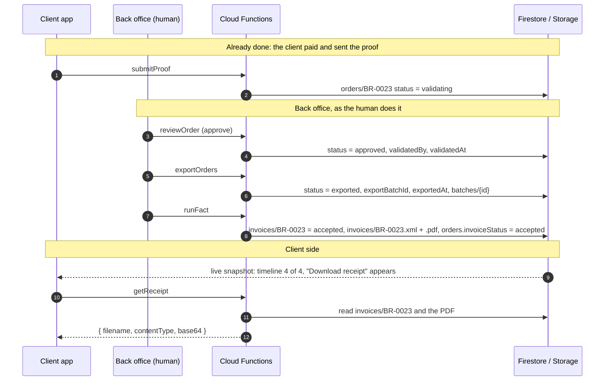

# From "validating" to the PDF receipt

How an order that the client already paid (status `validating`) finishes, and which fields change at each step. Shown with BR-0023.



## Fields

### `orders/{orderId}` (the only document the client watches)

| Field | Before | After approve | After export | After Fact | Used by |
|---|---|---|---|---|---|
| `status` | `validating` | `approved` | `exported` | `exported` | timeline steps 2-4 |
| `validatedBy` | `null` | staff email | same | same | audit |
| `validatedAt` | `null` | now | same | same | timeline step 2 timestamp |
| `rejectionReason` | `null` | `null` (set only on reject) | | | rejected notice |
| `exportBatchId` | `null` | `null` | `batches` id | same | audit, Dashboard file |
| `exportedAt` | `null` | `null` | now | same | audit |
| `invoiceStatus` | `null` | `null` | `null` | `accepted` | "received" step done, receipt button |
| `updatedAt` | | now | now | now | ordering |

Read but never changed in this flow: `uid` (owner), `orderId`, `email`, `docType`, `docNumber`, `commission`, `tax`, `sendCurrency`, `proofSubmittedAt`, `operationNo`, `paymentProofPath`.

### `batches/{id}` (written by `exportOrders`)

`id`, `type` (`"export"`), `orderIds[]`, `createdBy`, `createdAt`.

### `invoices/{orderId}` (written by `runFact`, read by `getReceipt`)

| Field | Example | Notes |
|---|---|---|
| `series`, `number`, `fullNumber` | `B001`, `1`, `B001-00000001` | number from `counters/invoice-B001.last` |
| `status` | `reserved` → `accepted` | `accepted` or `sent` makes the receipt downloadable |
| `issuer` | `INGENITECH S.A.C.` | derived from the send currency |
| `currency`, `taxableValue`, `tax`, `total` | `USD`, `2.4`, `0.43`, `2.83` | commission + tax, not the whole transfer |
| `uid` | owner's uid | `getReceipt` checks it against the caller |
| `xmlPath`, `pdfPath` | `invoices/BR-0023.xml`, `.pdf` | in Storage, written by the function only |
| `providerMessage`, `testMode` | `TEST MODE: accepted…`, `true` | no SUNAT / Omni yet |
| `emailedAt`, `createdAt`, `updatedAt` | `null`, ISO | no email is sent |

### Other

- `counters/invoice-B001.last`: the last invoice number issued.
- Storage `invoices/{orderId}.xml` and `.pdf`: the source and the receipt the client downloads.

## Replaying it

```bash
bun run functions:build
node functions/scripts/simulate-back-office.mjs BR-0023 --pdf receipt.pdf   # approve, export, bill
node functions/scripts/simulate-back-office.mjs BR-0023 --reject            # or reject instead
```

The script makes the same writes as `reviewOrder`, `exportOrders` and `runFact` and runs the real billing code. It only acts on an order in `validating` and needs Application Default Credentials. Do not commit the PDF: it holds the client's data.
